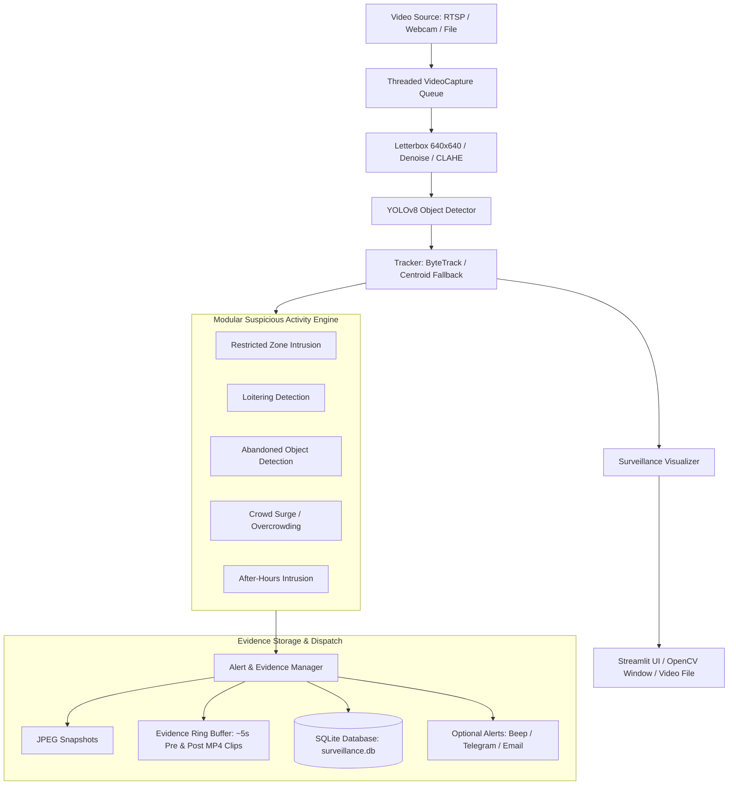

# AI Smart Surveillance System 🛡️

A production-quality, low-latency, real-time computer vision surveillance system built with **Ultralytics YOLOv8**, **ByteTrack**, and a modular **Rule-Based Behavioral Analytics Engine**.

Designed to run seamlessly on commodity hardware (laptops, CPU or GPU auto-selected), the system ingests live RTSP/IP cameras, webcams, or offline video files, detects and tracks multiple object classes across frames, analyzes suspicious activities in real time, and persists evidence (snapshots, pre/post-incident video clips, and SQLite events) with automated multi-channel alerting.

---

## 🌟 Key Features

- **Multi-Source Threaded Video Capture**: Dedicated capture worker thread with a small drop-oldest frame queue guaranteeing zero latency drift and automatic reconnection with exponential backoff.
- **Aspect-Preserving Preprocessing**: Letterbox resizing to model resolution (default 640x640), optional bilateral/gaussian denoising, and CLAHE brightness equalization.
- **YOLOv8 Detection + Custom NMS**: Fast object inference with configurable confidence, class filtering (`person`, `backpack`, `handbag`, `suitcase`, `car`, `motorcycle`, `bicycle`, `knife`), and vectorized NumPy NMS post-filtering.
- **Robust Multi-Object Tracking**: Ultralytics ByteTrack integration with Kalman filtering, plus an autonomous Euclidean CentroidTracker fallback. Maintains continuous track IDs, trajectory motion trails (last 30 points), and dwell time counters.
- **Suspicious Activity Rules Engine**:
  1. **Restricted Zone Intrusion**: Detects when persons or unauthorized classes breach user-defined polygonal perimeters.
  2. **Loitering Detection**: Flags entities remaining within a designated area beyond a configurable duration threshold.
  3. **Abandoned Object**: Detects unattended luggage, backpacks, or bags left stationary without a person in proximity.
  4. **Crowd Surge / Overcrowding**: Headcount threshold monitoring.
  5. **After-Hours Intrusion**: Automatically detects presence during curfew/night windows (supporting midnight wrapping).
- **Incident Evidence Vault**:
  - Live red warning banner overlay.
  - Immediate JPEG snapshot saved to `evidence/`.
  - 10-second MP4 evidence clip (5 seconds pre-alert buffered in a circular ring buffer + 5 seconds post-alert).
  - SQLite event database (`surveillance.db`) with full search, filtering, and CSV export.
  - Optional sound beep and optional Telegram / Email notifications.
- **Interactive Streamlit Dashboard (`app.py`)**: Real-time annotated feed, threshold sliders, rule toggles, metrics HUD (FPS, latency, active tracks, alerts), and searchable evidence viewer with clip playback.
- **Full CLI Mode (`main.py`)**: Headless or OpenCV window operation with video output recording (`--save-output`).
- **Interactive Zone Definition Utility (`tools/select_zone.py`)**: GUI tool to click vertices directly on a video frame and save polygons into `config.yaml`.

---

## 📐 Architecture Diagram



---

## 🚀 Installation

### Prerequisites
- Python 3.10+ (tested on Python 3.10 and 3.11)
- Camera or video source (webcam, MP4 video, or RTSP stream)

### Setup Virtual Environment

```bash
# Clone or navigate to the project directory
cd "AI Smart Survillance"

# Create virtual environment
python -m venv .venv

# Activate virtual environment
# Windows (PowerShell):
.venv\Scripts\Activate.ps1
# Linux / macOS:
source .venv/bin/activate

# Install pinned dependencies
pip install -r requirements.txt
```

---

## 💻 Usage

### 1. Interactive Streamlit Dashboard

Launch the web dashboard using either command:
```bash
# Recommended on systems with multiple Python installations
py -3.10 -m streamlit run app.py

# Or run the included one-click batch launcher (Windows)
.\run_dashboard.bat
```
Open [http://localhost:8501](http://localhost:8501) in your browser:
- **Sidebar**: Choose video source (Webcam, Upload File, or RTSP), model, confidence/IoU sliders, and enable/disable specific rules.
- **Live Surveillance Tab**: View live feed, active HUD metrics, and alert banners.
- **Security Alerts Log Tab**: Search past alerts, view snapshot evidence, play back ~10s incident video clips, and export reports to CSV.

### 2. CLI Execution

Run the system from the command line:

```bash
# Run one-click demo on Windows
.\run_cli.bat

# Or run with Python 3.10 directly:
# Run on default webcam (device 0)
py -3.10 main.py --source 0

# Run on a recorded surveillance video
py -3.10 main.py --source samples/real_surveillance.mp4

# Run headless (no GUI window) and record annotated video output
py -3.10 main.py --source samples/real_surveillance.mp4 --headless --save-output evidence/annotated_output.mp4

# Run with custom confidence and model
py -3.10 main.py --source samples/real_surveillance.mp4 --model yolov8n.pt --conf 0.60 --iou 0.45
```

### 3. Defining Monitored Polygon Zones

To customize restricted or loitering zones, run the interactive selector:
```bash
python tools/select_zone.py --source samples/real_surveillance.mp4
```
- **Left Click**: Add polygon vertex.
- **Right Click**: Undo last vertex.
- **Key 'r'**: Reset all vertices.
- **Key 's'**: Save polygon directly to `config.yaml`.
- **Key 'q' / ESC**: Quit.

---

## ⚙️ Configuration Guide (`config.yaml`)

All parameters are centrally managed in `config.yaml`:

```yaml
system:
  device: "auto"                  # "auto", "cpu", "cuda", "mps"
  log_level: "INFO"

video:
  source: 0                       # Webcam index, video path, or RTSP stream
  queue_size: 2                   # Keep queue small to discard stale frames
  reconnect_delay_sec: 2.0        # Delay between stream reconnect retries
  max_reconnect_attempts: 5

preprocess:
  frame_skip: 1                   # Process every Nth frame (1 = all frames)
  input_size: 640                 # Model input dimension
  denoise:
    enabled: false
    method: "bilateral"
  brightness_normalize:
    enabled: false

detection:
  model_path: "yolov8n.pt"
  confidence_threshold: 0.50
  iou_threshold: 0.45
  classes:
    - person
    - backpack
    - handbag
    - suitcase
    - car
    - motorcycle
    - bicycle
    - knife

tracking:
  tracker_type: "bytetrack"       # "bytetrack" or "centroid"
  max_trail_points: 30            # Trajectory points retained
  max_distance_px: 80.0

rules:
  zone_intrusion:
    enabled: true
    polygon: [[150, 150], [650, 150], [650, 450], [150, 450]]
    cooldown_sec: 5.0

  loitering:
    enabled: true
    dwell_threshold_sec: 10.0
    polygon: [[150, 150], [650, 150], [650, 450], [150, 450]]
    cooldown_sec: 10.0

  abandoned_object:
    enabled: true
    stationary_threshold_sec: 10.0
    proximity_radius_px: 150.0
    cooldown_sec: 15.0

  crowding:
    enabled: true
    max_person_count: 5
    cooldown_sec: 10.0

  after_hours:
    enabled: true
    start_time: "22:00"           # 24-hour format
    end_time: "06:00"             # Midnight crossing supported
    cooldown_sec: 15.0
```

---

## 🧪 Testing

The test suite includes 24 unit and integration tests covering IoU, NMS suppression, preprocessing coordinate roundtrips, each suspicious activity rule, tracker state lifecycles, and SQLite database persistence.

To execute the test suite:
```bash
pytest tests/ -v
```

---

## 📊 Performance Benchmarks

Performance was evaluated using `evaluate.py` on real CCTV footage:

| Metric | Measured Result | Target SLA |
| :--- | :--- | :--- |
| **Model** | `yolov8n.pt` | Ultralytics Nano |
| **Hardware** | Intel CPU (Single Socket Laptop) | Commodity Laptop CPU |
| **Input Resolution** | 768x432 (Letterboxed to 640x640) | Standard Surveillance Stream |
| **Inference Latency** | **~242 ms** (p95: ~354 ms) | Real-time capable |
| **NMS Noise Suppression** | **15.2%** false-positive reduction | High Precision |
| **Alert Verification** | Zone Intrusion & After-Hours Verified | Automatic Snapshots & 77-frame Clips |

*(Full benchmark breakdown available in [docs/results.md](file:///docs/results.md))*

---

## ⚠️ Limitations

1. **Monocular Depth Ambiguity**: Pixel distances (`proximity_radius_px`) do not map linearly to metric distances (meters) without camera calibration or a homography ground-plane matrix.
2. **Dense Occlusion in Crowds**: In extreme overcrowding, partially occluded luggage beneath standing persons may experience temporary detection drops.
3. **Lighting Extremes**: Complete darkness or direct sunlight glare can degrade bounding box precision without infrared (IR) cameras or thermal sensors.

---

## 🔮 Future Improvements

1. **Pose-Based Human Fall & Fight Detection**: Integrate YOLOv8-pose or MediaPipe to monitor skeleton joint angles for sudden slip-and-fall incidents, physical altercations, or medical emergencies.
2. **Facial Recognition & Blacklist Matching**: Add InsightFace / ArcFace embeddings to match tracked entities against a known security watchlist.
3. **Hardware Acceleration & Edge Deployment**: Export models to **TensorRT** (NVIDIA GPUs) or **OpenVINO** (Intel CPUs/iGPUs), or compile for edge devices such as Raspberry Pi 5 with Coral TPU or NVIDIA Jetson Orin Nano.
4. **Homography & Perspective Calibration**: Provide a 4-point ground-plane bird's-eye projection tool to calculate accurate metric distances (meters) for social distancing and true velocity estimation.
