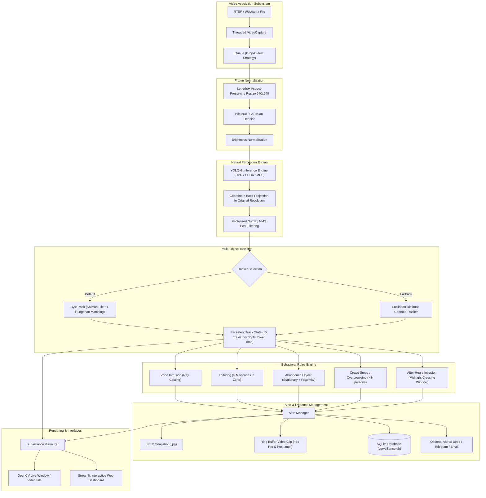

# AI Smart Surveillance System - Architecture & Design Specification

## System Topology & Dataflow

## Key Architectural Principles

1. **Decoupled Asynchronous Video Capture**:
   VideoCapture runs in its own OS thread. A size-constrained queue (default size 2) immediately discards stale frames when inference is running. This eliminates buffer lag and guarantees that incoming frames reflect real-world time.

2. **Bidirectional Coordinate Inversion**:
   Frames are normalized to square letterbox dimensions for convolutional inference, and resulting coordinates are mathematically inverted to match native camera coordinates before bounding boxes, polygon checks, or trails are evaluated.

3. **Multi-Object State Lifecycle**:
   Every tracked object maintains an anchor position, last movement time, total dwell time, and a circular deque containing the last 30 foot positions. This enables trajectory trail rendering and stationary duration calculation without global coordinate bloat.

4. **Circular Evidence Ring Buffer**:
   Video clips are not simply started at the moment of an alert. A 300-frame circular ring buffer continuously caches recent frames, so when an incident triggers, the preceding 5 seconds are seamlessly prepended to the following 5 seconds to provide full investigative context.
